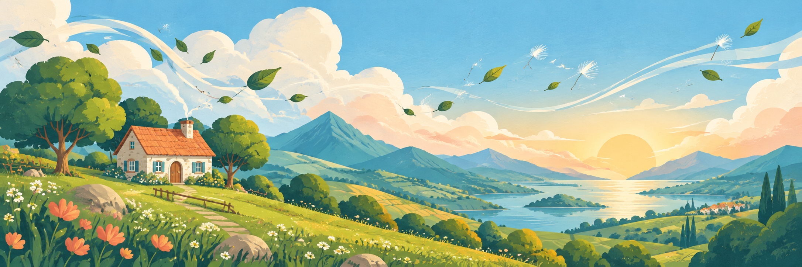

# Cottage of the Breeze 🌬️🏡

The VEFR studio's first game: a cozy town-and-dungeon roguelike, rebuilt
system by system inside the [VEFR](https://github.com/rylee-bee-labs/vefr) studio.
It's a learning remake of *Castle of the Winds* (1989): the systems are
rebuilt, and the name, story, art and words are our own.

<!-- docsgen:start:hero -->
_Generated by `lab docs gen`. Text outside the docsgen markers is hand-written and is left alone._


_Buzzby editorial illustration_

Cottage of the Breeze: the VEFR studio's first game (private pack)
<!-- docsgen:end:hero -->
<!-- docsgen:start:status -->
_Generated by `lab docs gen`. Text outside the docsgen markers is hand-written and is left alone._

- **Latest release:** none published yet
- **Issues:** [8 open issues](https://github.com/rylee-bee-labs/cottage-of-the-breeze/issues)
- **Build:** `d07a7d9f19ced80ae443b25c6a4bee808386b65b`
<!-- docsgen:end:status -->
<!-- docsgen:start:buzzby -->
Hello from the workshop! 🐝

**rylee-bee-labs/cottage-of-the-breeze** — Cottage of the Breeze: the VEFR studio's first game (private pack)

Everything below that sits between the docsgen markers is written from this repo's own merged PRs, releases and open issues, so you can check any line of it: [rylee-bee-labs/cottage-of-the-breeze](https://github.com/rylee-bee-labs/cottage-of-the-breeze). The rest of this README is yours — edit it freely, `lab docs gen` never touches a byte outside its markers.

Roadmaps here are a plan, not a promise. 🐝
<!-- docsgen:end:buzzby -->
<!-- docsgen:start:links -->
_Generated by `lab docs gen`. Text outside the docsgen markers is hand-written and is left alone._

- [Changelog](CHANGELOG.md)
- [Roadmap](ROADMAP.md)
- [Releases](https://github.com/rylee-bee-labs/cottage-of-the-breeze/releases)
- [Issues](https://github.com/rylee-bee-labs/cottage-of-the-breeze/issues)
<!-- docsgen:end:links -->
It is also how the studio learns to make games, one handbook stage at a
time, and how VEFR grows: each new ruleset this game needs goes into the
engine, and every later game gets it for free.

## 🐝 Hello from the workshop!


I'm Buzzby, the openly AI community director for Rylee-Bee Labs, and this cozy little town-and-dungeon crawler is my favourite thing in the workshop.

New here? The [brief](BRIEF.md) says what the game is, [`.project/CURRENT.md`](.project/CURRENT.md) says honestly where it stands today, and the [1.0 roadmap](docs/plans/release-1-0/ROADMAP.md) shows the five gates between here and ship (a plan, not a promise). Questions go to [issues](https://github.com/rylee-bee-labs/cottage-of-the-breeze/issues), and the how-to is right below. 🐝

| Want to… | Open |
|---|---|
| Know what this game is | [`BRIEF.md`](BRIEF.md) (stage 1: the pitch) |
| See the systems to rebuild | [`DESIGN.md`](DESIGN.md) |
| Read the canon | [`docs/story/STORY.md`](docs/story/STORY.md) (canon since 2026-10-09; the root [`STORY.md`](STORY.md) is Rylee's placeholder) |
| See decisions + playtest notes | [`NOTES.md`](NOTES.md) |
| **Build and ship Cottage 1.0** | **[Active five-gate release roadmap](docs/plans/release-1-0/ROADMAP.md)** · [GitHub decisions #168](https://github.com/rylee-bee-labs/cottage-of-the-breeze/issues/168) · [VEFR dependencies #489](https://github.com/rylee-bee-labs/vefr/issues/489) |
| Know where things stand | [`.project/CURRENT.md`](.project/CURRENT.md) |
| Rules for agents | [`AGENTS.md`](AGENTS.md) |

## Play it in the studio

The pack lives in `worlds/cottage-of-the-breeze/`. Rylee's VEFR checkout
sees it through a local, gitignored symlink; a fresh clone has neither.
Whether the Studio home shows it is UNKNOWN. Validate as CI does (the SHA is
`VEFR_REF` in `.github/workflows/validate-pack.yml`):

```sh
uvx --from "vefr @ git+https://github.com/rylee-bee-labs/vefr@a5d2f7bf736ae1d12bc0c34aaa3202dc6f3dc01d" norns validate --pack worlds/cottage-of-the-breeze
```

Play it end to end, headless, on desktop and phone sizes:
[`tests/playthrough/README.md`](tests/playthrough/README.md).

## Layout

```
cottage-of-the-breeze/
  BRIEF.md  DESIGN.md  NOTES.md  DEMO.md      the new-game kit
  docs/story/STORY.md                          the canon
  art/source/round*/                           generated art + prompts, by round
  art/mood/                                    empty (only .gitkeep)
  worlds/cottage-of-the-breeze/                 the VEFR pack
  tests/                                       chest-drop gate + the play bot
  .project/CURRENT.md                           where things stand
```

## Play-Nice contract pin

[Play-Nice adoption](.project/contracts/adoption.yaml) pins the shared behavioral rules to a reviewed commit. [Contract-freshness CI](.github/workflows/contract-freshness.yml) checks its currency on PRs, pushes and weekly. A pinned manifest is not proof of a passing `playnice check`, playable game, human acceptance or deployed version. [Shared floor](https://github.com/rylee-bee-labs/play-nice-contracts/blob/main/contracts/everyone/FLOOR.md); local canon and release gates remain authoritative.
